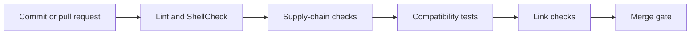

# OMES Continuous Integration

> Status: implemented. Describes the CI as it exists in this repository today —
> `.github/workflows/lint.yml`, `.github/workflows/compatibility.yml`,
> `.github/workflows/upstream-drift.yml`,
> `.github/dependabot.yml`, `.gitleaks.toml`, `.yamllint.yml`, and the
> `scripts/lint.sh` / `scripts/check-supply-chain.sh` / `scripts/check-links.py` /
> `scripts/test-matrix.sh` scripts those workflows call, plus
> `scripts/ci-local.sh`, which runs every one of those jobs on a developer
> machine without GitHub Actions and is the **required per-PR check** (§1, §10).
> The GitHub Actions workflows run **only on manual dispatch** (issue
> [#312](https://github.com/ahliweb/omes/issues/312)). See
> [docs/security.md](security.md) sections 6-7 for the supply-chain and
> release-gate *requirements* this CI implements, and
> [docs/testing.md](testing.md) for how `scripts/test-matrix.sh` maps onto the
> compatibility-matrix support tiers.
>
> The core installer (`bin/omes`, `lib/omes/*.sh`, `modules/`, `tests/run.sh`,
> `.shellcheckrc`) is implemented and present on `main`. The lint and
> compatibility workflows still
> carry `if: hashFiles('<path>') != ''` guards around the steps that depend on
> it — these are now inert no-op branches (the files always exist), kept only
> so a stripped-down fork or an unusually early checkout does not hard-fail;
> they are not evidence that the installer is missing.

## 1. Workflows

> **Where CI runs now (issue [#312](https://github.com/ahliweb/omes/issues/312)).**
>
> - **Local CI is the required per-PR check.** Run `scripts/ci-local.sh` (§10) before
>   pushing and paste its summary table into the pull request description. Exit
>   code 0 is a pass; 1 (a blocking job failed) and 3 (incomplete: a blocking job was
>   skipped, for example no Docker or a shallow clone) are not. For installation,
>   package, platform or rollback changes use `--profile full` as well.
> - **GitHub Actions runs only on manual `workflow_dispatch`.** `lint.yml`,
>   `compatibility.yml` and `upstream-drift.yml` have no `pull_request`, `push` or
>   `schedule` trigger any more. Dispatch them by hand when GitHub check runs are
>   wanted — for example on a pull request head when branch protection requires
>   them, or on the release commit as a release gate:
>
>   ```bash
>   gh workflow run lint.yml --ref <branch>
>   gh workflow run compatibility.yml --ref <branch>
>   gh workflow run upstream-drift.yml --ref main   # also creates/updates the drift tracking issue
>   ```
>
>   Job names, steps, pinned actions and permissions are unchanged, so a dispatch
>   produces the same check runs as before.
> - **Owner action required — not done by this change.** Branch protection's
>   *required status checks* are a repository setting that lives outside the
>   repository files; nothing in this repository changes them. Until the repository
>   owner updates them, a pull request that still requires the old check names has
>   no check run to wait for and waits for someone to dispatch the workflows on its
>   head (Dependabot's `github-actions` update pull requests included).
> - **Trade-off.** A local summary is self-reported. GitHub does not enforce that
>   `scripts/ci-local.sh` was run, that it passed, or that it ran on the commit being
>   merged; the summary records the commit and whether the working tree was dirty so
>   a reviewer can compare it with the pull request head, but that is evidence, not
>   enforcement. The GitGuardian GitHub App check is a GitHub App rather than an
>   Actions workflow, so this change does not affect it and it keeps running on pull
>   requests.

### 1.1 `.github/workflows/lint.yml`

Trigger: manual `workflow_dispatch` only (the `pull_request` and `push` triggers
were removed by issue #312). Dispatching again on the same ref cancels and
replaces the earlier run (`concurrency` with `cancel-in-progress: true`). Every
job requests only `permissions: contents: read` — no job in this workflow needs
to write to the repository, comment on pull requests, or write security-events.

"Blocking" below is what each job reports: a failing blocking job fails the
dispatched run, and `scripts/ci-local.sh` treats it as blocking. Whether a
dispatched check also gates a *merge* depends on branch protection (see the owner
action above).

| Job | What it does | Blocking? |
|---|---|---|
| `shellcheck` | Runs `scripts/lint.sh shellcheck` — ShellCheck at `-S warning` (blocking) then `-S style` (reported, not blocking) over every shell file in scope (§2.1). | **Yes** (at `warning` severity and above). Style-level findings are printed but do not fail the job. |
| `shfmt` | Runs `scripts/lint.sh shfmt` — `shfmt -i 2 -ci -bn -d` (diff mode) over the same file set. | **No.** `continue-on-error: true`. See §3 for why. |
| `bats` | Installs `bats` (apt) and runs `tests/run.sh` (ShellCheck + unit + integration, per [ADR-0009](adr/0009-testing-with-bats-in-containers.md)). | **Yes**, when the workflow runs successfully. |
| `gitleaks` | Full git-history secret scan via `gitleaks/gitleaks-action`, checked out with `fetch-depth: 0` so history (not just the diff) is scanned. | **Yes.** |
| `yamllint` | Runs `scripts/lint.sh yamllint` over every tracked `*.yml`/`*.yaml` file (primarily `.github/workflows/*`), using `.yamllint.yml`. | **Yes.** |
| `actionlint` | Runs `rhysd/actionlint` (via Docker, pinned by image digest) against `.github/workflows/*.yml`. | **Yes.** |
| `supply-chain` | Runs `scripts/check-supply-chain.sh` (§4). | **Yes**, for the action-pinning and unsafe-pipe checks. The external-URL listing is informational only. |
| `check-links` | Runs `scripts/check-links.py` (§5) over every tracked `*.md` file. | **Yes**, for a link whose *target file* does not exist. Anchor-only mismatches are printed as advisory warnings. |
| `check-contracts` | Runs `scripts/check-contracts.py` over `contracts/**/fixtures` against their JSON Schema specifications. | **Yes.** |
| `check-architecture` | Runs `scripts/check-architecture.py` to enforce ADR-0017 capability registry and layer boundaries. | **Yes.** |
| `check-control-center-data` | Runs `scripts/generate-control-center-data.py --check` to catch a stale `ui/control-center/data.js` (issue #211) — see [ui/control-center/README.md](../ui/control-center/README.md). | **Yes.** |
| `validate-change-fragments` | Runs `scripts/release.sh --validate-fragments` (issue #238) to reject a malformed `changes/*.md` fragment on the pull request that introduces it, using the exact same parser `scripts/release.sh` uses to compile `CHANGELOG.md` at release time — see §9. | **Yes.** |


### 1.2 `.github/workflows/compatibility.yml`

Trigger: manual `workflow_dispatch` only (the `pull_request`, `push` and weekly
Monday 03:17 UTC `schedule` triggers were removed by issue #312; the
`graphify-real-smoke` job keeps its `if:` guard for `schedule`/`workflow_dispatch`,
which now can only be satisfied by a manual dispatch). Same
`concurrency`/`cancel-in-progress` policy as `lint.yml`. `permissions:
contents: read` throughout. As of issue [#15](https://github.com/ahliweb/omes/issues/15),
both jobs below run `scripts/test-matrix.sh` (§2.6 of this document,
`docs/testing.md`) rather than a handful of `bin/omes` invocations inline in
the workflow — the workflow is a thin GitHub Actions wrapper around that
script, which itself does its own `docker run`/`docker exec` against the
target OS images (hence running on the GitHub-hosted runner directly, not
inside a `container:` job).

| Job | What it does | Blocking? |
|---|---|---|
| `matrix` | For each of `ubuntu:26.04` (tier 1), `ubuntu:24.04` (tier 1), `linuxmintd/mint22-amd64` (tier 1), and `ubuntu:22.04` (tier 2, `continue-on-error: true`): runs `scripts/test-matrix.sh` for that one image, covering all seven scenarios (`fresh`, `rerun`, `offline`, `partial-failure`, `reboot`, `rollback`, `dr`) against a **real** `apt-get`/`dpkg` inside a disposable container. Uploads `tests/matrix/results/` and `tests/matrix/logs/` as a build artifact per image. | **Yes** for the three tier-1 images; the tier-2 `ubuntu:22.04` row is advisory (`continue-on-error: true`). |
| `real-install-ubuntu-26-04` | On `ubuntu:26.04` only, as root: `scripts/test-matrix.sh` restricted to `OMES_MATRIX_SCENARIOS="fresh rerun"` — a **real**, non-dry-run `apt-base` install run twice in a row to prove idempotency end to end. Uploads the same artifacts. | **Yes.** `continue-on-error: false` — blocking since issue #167. |
| `real-install-ubuntu-24-04` | On `ubuntu:24.04` only, as root: `scripts/test-matrix.sh` restricted to `OMES_MATRIX_SCENARIOS="fresh rerun"` — a **real**, non-dry-run `apt-base` install run twice in a row to prove idempotency end to end. Uploads the same artifacts. | **Yes.** `continue-on-error: false` — blocking since issue #15, now that `apt-base` gives this job a real module to install. Kept as its own named job (duplicating part of the `matrix` job's ubuntu:24.04 coverage) so its pass/fail history stays visible on its own. |

**Compatibility-matrix mapping.** `docs/compatibility-matrix.md` section 1
defines four support tiers; this workflow covers exactly the **Tier 1**
platforms for the `server` profile (`ubuntu:26.04`, `ubuntu:24.04`) and one representative of
Tier 1 desktop (`linuxmintd/mint22-amd64`, standing in for Linux Mint 22.x —
see `scripts/test-matrix.sh`'s own "known limitations" comment for why its
`/etc/os-release` actually reports `ID=ubuntu`) plus the Tier 2
`ubuntu:22.04`. Per compatibility-matrix.md section 1, Tier 1 platforms must
be tested "in CI containers **and** in a VM before every release" — this
workflow is the CI-container half of that requirement; the VM half is
`tests/vm/` (see compatibility-matrix.md section 7 and `docs/testing.md`).
Tier 2 (`ubuntu:22.04`) is tested "periodically, not on every release" per
that same table — since issue #312 there is no automatic cadence: it runs when
`scripts/ci-local.sh --profile full` is run or this workflow is dispatched, so
the periodic coverage the table asks for now depends on someone doing that
(Not automated; an owner decision under #312). Tier-1 coverage "before every
release" likewise needs this workflow dispatched on the release commit, or a
`--profile full` evidence file for it; `scripts/release.sh` refuses to cut a release
without one of the two (§8). Promoting a new platform to Tier 1
requires adding it to this workflow's matrix, per compatibility-matrix.md
section 6, step 6.

### 1.3 `.github/workflows/upstream-drift.yml`

Trigger: manual `workflow_dispatch` only (it ran weekly, Mondays 06:00 UTC,
before issue #312). One job, `drift-review`: `python3
scripts/upstream-drift.py --update-issue` inspects public upstream releases
(Hermes, Omarchy, Graphify, Coolify) against `architecture/capabilities.json`
([ADR-0026](adr/0026-upstream-drift-automation.md)) and creates or updates a
single deduplicated tracking issue when the drift is actionable. That needs the
workflow's `GITHUB_TOKEN` (`issues: write`), so **updating the tracking issue now
requires dispatching this workflow by hand**. The local equivalent is report-only:
`scripts/ci-local.sh --job upstream-drift` runs `python3
scripts/upstream-drift.py` with no `--update-issue` and no token, prints the drift
report and never writes to GitHub (§10.2). It is advisory: a blocked inspection
(no network, API denied) is reported as `skipped`, not as a failure.

## 2. Running the checks locally

`scripts/ci-local.sh` (§10) runs all of the checks below with the right blocking
rules and is the required per-PR check; this section lists the underlying
commands for running one of them on its own.

### 2.1 `scripts/lint.sh` — ShellCheck, shfmt, yamllint

```bash
scripts/lint.sh              # everything (shellcheck + shfmt + yamllint)
scripts/lint.sh shellcheck   # ShellCheck only (same two-pass warning/style split as CI)
scripts/lint.sh shfmt        # shfmt diff only
scripts/lint.sh yamllint     # yamllint only
```

File scope for ShellCheck/shfmt (matches the `shellcheck` and `shfmt` CI
jobs exactly, since both call this same script): every tracked path ending
in `.sh` (this already covers `modules/**/*.sh` and `lib/**/*.sh`), every
tracked `tests/**/*.bash`, and every tracked path under `bin/` or
`install/` that is a shell script by shebang or MIME type (`file
--mime-type`) — this catches an extensionless entry point like `bin/omes`
without also picking up a non-shell file that happens to live in `bin/`.

The script uses a locally installed `shellcheck`/`shfmt`/`yamllint` when
present (GitHub-hosted `ubuntu-24.04` runners ship ShellCheck by default),
and otherwise falls back to the pinned Docker images named at the top of
`scripts/lint.sh`, so local and CI results should not diverge.

### 2.2 `scripts/check-supply-chain.sh`

```bash
scripts/check-supply-chain.sh
```

See §4 below for what it checks.

### 2.3 `scripts/check-links.py`

```bash
python3 scripts/check-links.py                 # every tracked *.md file
python3 scripts/check-links.py docs/ci.md ...   # or specific files
```

See §5 below.

### 2.4 gitleaks (full history)

```bash
scripts/ci-local.sh --job gitleaks
```

This runs the pinned gitleaks image (§6, §10.7) over the full git history with
`.gitleaks.toml`, mounting the main repository's git directory as well when you
are in a linked `git worktree`, and refuses to report a pass on a shallow
clone. The equivalent by hand, from the repository root of a full clone:

```bash
docker run --rm --user "$(id -u):$(id -g)" -v "$PWD:/repo:ro" -w /repo \
  -e GIT_CONFIG_COUNT=1 -e GIT_CONFIG_KEY_0=safe.directory -e GIT_CONFIG_VALUE_0='*' \
  zricethezav/gitleaks@sha256:c00b6bd0aeb3071cbcb79009cb16a60dd9e0a7c60e2be9ab65d25e6bc8abbb7f \
  git --no-banner --redact -v --exit-code=2 --config /repo/.gitleaks.toml /repo
```

`--redact` keeps any genuine finding's secret value out of the command's own
output. From a linked `git worktree`, also mount the main repository's `.git`
directory at the same absolute path (`-v "$GIT_COMMON_DIR:$GIT_COMMON_DIR:ro"`)
so the `gitdir:` link inside the worktree's `.git` file resolves.

### 2.5 actionlint

```bash
docker run --rm -v "$PWD:/repo" -w /repo \
  rhysd/actionlint@sha256:b1934ee5f1c509618f2508e6eb47ee0d3520686341fec936f3b79331f9315667 \
  -color
```

### 2.6 bats

```bash
./tests/run.sh
```

Per [ADR-0009](adr/0009-testing-with-bats-in-containers.md), this implemented gate runs
ShellCheck plus `tests/unit/*.bats` and `tests/integration/*.bats`, using
Docker (`bats/bats:latest`) when `bats` is not installed locally.

## 3. What blocks merge vs. what is advisory

This classification is what each job reports, locally (`scripts/ci-local.sh`) and
in a dispatched workflow alike. Since issue #312 nothing on GitHub forces the
jobs to run: a job gates a merge only if the owner has required its check in
branch protection *and* it has been dispatched (§1), or if the reviewer requires
the pull request's pasted local summary to be `pass` (§10.3).

**Blocking** (a failing job fails the run): `shellcheck` (at
`warning` severity), `bats` (`tests/run.sh`, which also runs
`scripts/release.sh --validate-fragments` — see §9), `gitleaks`, `yamllint`,
`actionlint`, `supply-chain` (action pinning + unsafe-pipe checks),
`check-links` (broken link *targets*), `validate-change-fragments`
(`scripts/release.sh --validate-fragments`, redundant with the check inside
`bats`/`tests/run.sh` on purpose — it is also its own named job so a
malformed fragment's failure is visible on its own line, the same rationale
`real-install-ubuntu-24-04` uses in §1.2), the `compatibility.yml` `matrix`
job's `ubuntu:24.04`/`linuxmintd/mint22-amd64` (tier 1) rows, and the
`real-install-ubuntu-24-04` job (blocking since issue #15 — `apt-base` gives
it a real module to install and re-install idempotently).

**Advisory** (reported, does not fail the run): `shfmt` — the
repository's shell code has landed but its formatting conventions are still
being established; making `shfmt` blocking before there is an agreed,
enforced style would make every future formatting-convention decision a
breaking CI change instead of a deliberate, reviewed one. Also advisory:
`check-supply-chain.sh`'s external-download-URL listing (informational, for
human review, never fails), `check-links.py`'s anchor-only warnings (the
heading-to-slug matching is a best-effort approximation of GitHub's own
algorithm and can have false positives), and `compatibility.yml`'s
`ubuntu:22.04` (tier 2) row of the `matrix` job (`continue-on-error: true`,
see §1.2).

## 4. `scripts/check-supply-chain.sh`

Three checks, run against the working tree:

1. **Every `uses:` in `.github/workflows/*.yml` is pinned to a full 40-hex
   commit SHA.** A mutable tag or branch reference (`uses: actions/checkout@v4`)
   fails this check; `uses: actions/checkout@<40-hex-sha> # v7.0.1` passes.
   Local composite actions (`uses: ./...`) and Docker-image actions
   (`uses: docker://...`) are skipped, since neither is a tag-versioned
   GitHub Action reference. This implements the
   [docs/security.md](security.md) section 6 rule "GitHub Actions pinned by
   SHA."
2. **No tracked shell script pipes a network download directly into a
   shell interpreter.** The rule: the only permitted pattern for fetching a
   third-party installer is *download to a file first* (e.g. `curl -fsSL
   <url> -o <tmpfile>`), optionally verify a checksum, then execute that
   file as its own, separate step — never `curl ... | bash` or `wget ... |
   sh`. This is the same rule [ADR-0006](adr/0006-hermes-upstream-installer-with-pinning.md)
   and docs/security.md section 6 state for the Hermes installer,
   mechanically enforced here across every tracked shell script. A
   line that is a deliberate, reviewed exception may be marked with a
   trailing `# check-supply-chain: allow` comment (none exist today).
3. **External download URLs under `bin/`, `lib/`, `modules/`, `install/`
   are listed for human review.** Informational only — this never fails
   the check. It exists so a reviewer can see, in one place, every URL a
   PR's shell code would fetch from.

## 5. `scripts/check-links.py`

Scans every tracked `*.md` file for Markdown links
(`[text](target)`), skips absolute URLs (`http://`, `https://`, `mailto:`,
...) and same-page anchors (`#foo`), and resolves every remaining
*relative* link against the linking file's own directory. A link whose
target file does not exist is a hard failure. A link with a `#fragment`
whose target file exists, but where the fragment cannot be matched against
any Markdown heading in that file (via a best-effort approximation of
GitHub's heading-to-anchor slug algorithm), is printed as an advisory
warning rather than failing the job, since the slug heuristic is not exact.

## 6. SHA-pinning policy and how Dependabot updates pins

Per [docs/security.md](security.md) section 6: "Every third-party Action
referenced in `.github/workflows/*.yml` is pinned to a commit SHA, not a
mutable tag or branch. Bumping a pin is a reviewed change, not an automatic
update." Concretely:

- Every `uses: <owner>/<repo>@<ref>` in this repository's workflows uses a
  full 40-character commit SHA as `<ref>`, with a trailing `# vX.Y.Z`
  comment naming the human-readable release that SHA corresponds to (e.g.
  `uses: actions/checkout@3d3c42e5aac5ba805825da76410c181273ba90b1 # v7.0.1`).
  `scripts/check-supply-chain.sh` enforces this mechanically (§4.1).
- `.github/dependabot.yml` configures the `github-actions` package
  ecosystem with a weekly update schedule. Dependabot resolves the new
  release's commit SHA itself and opens a PR that updates both the SHA and
  the trailing version comment — it never leaves an action pinned to a
  moving tag. That PR goes through the same review and the same
  `lint.yml` checks (including `supply-chain`, which would fail the PR if
  Dependabot ever produced an unpinned or non-SHA reference) as any other
  change before it can merge — which, since issue #312, means a local
  `scripts/ci-local.sh` run on the PR branch or a manual dispatch of the
  workflows on its head: Dependabot's pull requests no longer get automatic check
  runs.
- To resolve a tag to its commit SHA by hand (e.g. when adding a new
  action Dependabot doesn't cover yet, or verifying a Dependabot PR):
  `gh api repos/<owner>/<repo>/git/ref/tags/<tag>` and read `.object.sha`
  (if `.object.type` is `tag` rather than `commit`, it is an annotated tag
  — follow `.object.url` one more level, e.g.
  `gh api repos/<owner>/<repo>/git/tags/<sha>`, to reach the underlying
  commit SHA). Never guess or hand-type a SHA.
- Docker images referenced by digest in `scripts/lint.sh`, in
  `lint.yml`'s `actionlint` step, and the gitleaks image in
  `scripts/ci-local.sh` (`image@sha256:...`) follow the same
  spirit — pinned to an immutable digest, not a mutable tag like `:latest`
  or `:stable` — but are not `uses:` GitHub Action references, so they are
  not covered by `scripts/check-supply-chain.sh`'s action-pinning check or
  by Dependabot's `github-actions` ecosystem. Bumping one of these digests
  is a manual, reviewed edit (re-resolve with `docker inspect --format
  '{{index .RepoDigests 0}}' <image>:<tag>` after pulling the tag you want;
  for the multi-architecture gitleaks image use `docker buildx imagetools
  inspect <image>:<tag>` and take the top-level index digest).

## 7. How to add a `.gitleaks.toml` allowlist entry

`.gitleaks.toml` extends gitleaks' built-in default ruleset
(`[extend] useDefault = true`) with an OMES-specific `[allowlist]`. Before
adding an entry:

1. Run the local full-history scan (§2.4) *without* your proposed entry
   and confirm it actually flags the line in question — do not add an
   allowlist entry speculatively.
2. Confirm by inspection that the flagged value is not a real secret (a
   test fixture, a documented placeholder like `TELEGRAM_BOT_TOKEN=changeme`,
   or an intentionally-fake example token shape used to illustrate what
   *not* to commit).
3. Add the narrowest entry that resolves the finding:
   - A whole-file/whole-directory exemption goes under `[allowlist].paths`
     as a regex anchored to the path (e.g. `'''^tests/fixtures/.*'''`) —
     use this only for fixtures that are inherently fake data by
     construction.
   - A specific string/pattern exemption goes under
     `[allowlist].regexes`, scoped as tightly as possible to the exact
     documented placeholder (not a broad pattern that could also match a
     real secret of the same shape elsewhere in the repository).
4. Re-run the local full-history scan (§2.4) and confirm it is now clean,
   then paste that output in the PR that adds the entry — the same
   evidence standard docs/security.md section 7's "No secret in the tree
   or history" release gate requires.
5. Never add an allowlist entry for a value that is, or was ever, a real
   credential — rotate it first (see `SECURITY.md`), then the finding
   remains in history by design (gitleaks scans history) and is not
   something an allowlist entry should hide.

## 8. Release automation and verification (`scripts/release.sh`)

Releases follow the authoritative sequence defined in [ADR-0010](adr/0010-versioning-and-change-fragments.md) and issue #168:

```bash
# 1. Non-mutating check / dry-run
scripts/release.sh <X.Y.Z> --dry-run

# 2. Cut release on clean main with green CI checks
scripts/release.sh <X.Y.Z>

# 3. Publish tag, create GitHub Release, and verify read-back
scripts/release.sh <X.Y.Z> --publish
```

`scripts/release.sh` enforces:
- Execution on clean `main` branch with no uncommitted changes.
- A **CI gate that fails closed** (issue [#315](https://github.com/ahliweb/omes/issues/315)).
  The workflows run on manual dispatch only (§1, issue #312), so a commit nobody dispatched
  them on has *zero* check runs. The earlier gate only failed on completed non-success runs,
  so it passed with zero check runs, and it skipped itself silently when `gh` was not
  installed. Now a release passes the gate only when the commit being released (HEAD when
  `release.sh` starts) has acceptable evidence from **at least one** of two sources (§8.1).
  With neither, `release.sh` exits 1, names the jobs that lack evidence and shows how to
  produce it. A missing `gh` skips nothing: only the local evidence source can pass without
  it. See also [docs/business/release-gates.md](business/release-gates.md).
- Compilation of all `changes/*.md` fragments into `CHANGELOG.md` and bump of `VERSION`.
- Synchronization of `README.md` version claims.
- Creation of an annotated git tag `v<X.Y.Z>` matching the exact release commit SHA.
- Refusal to retarget or force-move existing public release tags.
- Post-publish read-back verification: reads back the pushed git tag and the published GitHub Release.

### 8.1 The CI gate in detail

**Required jobs.** Every *blocking* job of the full profile, derived from the release
commit's own `scripts/ci-local.sh --list --json --profile full` (its job table, which the
`workflow-sync` job keeps equal to `lint.yml` and `compatibility.yml`; there is no second
workflow parser). Advisory jobs (`shfmt`, the Tier 2 `ubuntu:22.04` matrix row,
`graphify-real-smoke`) are not required. `--list --json` reports each job's GitHub
check-run name as `check_name`. An inherited `OMES_CI_WORKFLOWS_DIR` is ignored, and the
gate refuses to run when `.github/workflows`, `scripts/ci-local.sh` or
`scripts/release-ci-gate.py` differ from the release commit.

**Source 1 - GitHub check runs.** One `gh api --paginate
"repos/:owner/:repo/commits/<sha>/check-runs?per_page=100&filter=latest"` call (the same
call as before, now paginated; no other network call). For **every** required `lint.yml`
and `compatibility.yml` job there must be a check run with its display name, created by
GitHub Actions for that commit, with status `completed` and conclusion `success`. A job
that is missing, failed, cancelled, skipped, neutral or still running is no evidence; so is
a truncated response and a failing or unauthenticated `gh` call. Check runs from other
GitHub Apps never substitute for them: GitGuardian posts a successful check run on every
commit by itself, so a commit on which only GitGuardian ran still has no evidence. Produce
it with:

```bash
gh workflow run lint.yml --ref <tag-or-branch>
gh workflow run compatibility.yml --ref <tag-or-branch>
```

**Source 2 - local CI evidence file.** `scripts/ci-local.sh --profile full --json` run on
a clean, full-depth checkout of the release commit, saved to
`.omes-ci/ci-local-<sha>.json` (git-ignored; `--ci-evidence PATH` overrides the path):

```bash
mkdir -p .omes-ci
scripts/ci-local.sh --profile full --json > ".omes-ci/ci-local-$(git rev-parse HEAD).json"
```

`scripts/release-ci-gate.py` validates it strictly; anything malformed or missing is *no
evidence*. All of these must hold: valid JSON (no duplicate keys, no `NaN`) with `schema`
`omes-ci-local/1`; `result` `pass`, `exit_code` 0 and `profile` `full` (a `--job` or fast
run is rejected); `git.head` equal to the release commit SHA, `git.dirty` `false` and
`git.shallow` `false` (unknown does not count); `counts.fail` and `counts.blocking_skipped`
0, and no blocking job in any status but `pass`; every required blocking job present and
`pass`, including each `matrix:<image>` and `real-install-*` job; and a `generated_at` UTC
timestamp that is not in the future (a 5 minute clock-skew allowance). The file is
**self-reported**: it is bound to the commit SHA, but GitHub does not enforce, sign or
verify it, so it is exactly as trustworthy as the person who produced it (§10).

**Explicit opt-out.** `--skip-ci-check` still exists for an operator who consciously
accepts releasing without CI evidence. It is never the default, prints a prominent warning,
is written into the annotated tag message and appended to the GitHub Release notes
(`CI gate: SKIPPED with --skip-ci-check ...`), and is repeated in the final log line.

**`--dry-run`** stays non-mutating and network-free: it never calls `gh`. It prints the
local-evidence verdict and, when the gate would currently fail, a `[dry-run] CI gate would
currently FAIL` warning with the missing jobs, but it does not fail the dry run.

Tests: `tests/unit/release-ci-gate.bats` (fake `gh`: `tests/shims/gh`).

## 9. `scripts/release.sh --validate-fragments` (issue #238)

Cutting `v0.4.0` found that 22 of 32 pending `changes/*.md` fragments could
not be compiled by `scripts/release.sh`, all of which had merged through
green CI — the problem only surfaced at release time, when it blocked the
release. `--validate-fragments` closes that gap by running the exact same
fragment parser `scripts/release.sh` uses to compile `CHANGELOG.md` (both
paths call the same `fragment_errors` shell function in
`scripts/release.sh`, so CI and the release can never disagree about what a
valid fragment looks like), in the local per-PR check and in the dispatched
workflow, before a bad fragment can merge.

```bash
scripts/release.sh --validate-fragments
```

It validates every `changes/*.md` file against the ADR-0010 rules (see
[CONTRIBUTING.md](../CONTRIBUTING.md) §4 for the exact rule list: valid
frontmatter, a positive-integer `issue`, an ADR-0010 `type`, and a
single-paragraph, non-empty body), reports **every** bad fragment (not
just the first), and exits non-zero if any fragment is invalid. It is
strictly read-only: no `VERSION`/`CHANGELOG.md`/git mutation, no network
access, no `gh` calls, and none of `scripts/release.sh`'s clean-tree,
main-branch, or CI-status preconditions apply. It exits 0 when `changes/`
is empty, does not exist, or contains only a `README.md`/placeholder file.

This check is blocking without any branch-protection change, by running
in two places (both are part of `scripts/ci-local.sh`):
- inside `tests/run.sh` (the `bats` job of §1.1), so a
  malformed fragment fails the same check every other test failure
  does;
- as its own named `validate-change-fragments` job in
  `.github/workflows/lint.yml`, so the failure is visible on its own line
  rather than buried inside the `bats` job's output, mirroring how
  `check-control-center-data` is wired.

`scripts/lint.sh` also runs it (`scripts/lint.sh validate-fragments`, and
as part of `scripts/lint.sh` with no arguments), for parity with the
other checks in this document that have both a `tests/run.sh` and a
`scripts/lint.sh` entry point.

## 10. Running the full CI locally (no GitHub Actions)

Issue [#312](https://github.com/ahliweb/omes/issues/312).
`scripts/ci-local.sh` reproduces every job of `.github/workflows/*.yml` on a
developer machine or an agent sandbox, with the same command and the same
blocking semantics as the workflow YAML, and prints one summary (a Markdown
table, or JSON) that can be pasted into a pull request description.

> **This is the required per-PR check; GitHub Actions runs only on manual
> dispatch** (§1). Paste the summary table into the pull request description. The
> local runner produces evidence; it does not enforce anything on GitHub, and its
> results are self-reported. The branch-protection settings that decide which
> GitHub checks a merge waits for are the repository owner's to update — this
> repository's files do not change them (§1, "Owner action required").

### 10.1 Usage

```bash
scripts/ci-local.sh                         # --profile fast: every lint.yml job + workflow-sync
scripts/ci-local.sh --profile full          # fast + the compatibility.yml container matrix (slow)
scripts/ci-local.sh --job shellcheck --job bats   # only these jobs (repeatable; also comma-separated)
scripts/ci-local.sh --job matrix:ubuntu:24.04     # one matrix image; `--job matrix` selects all of them
scripts/ci-local.sh --list [--json]         # job names, commands and blocking status
scripts/ci-local.sh --json                  # one JSON document on stdout; logs go to stderr
scripts/ci-local.sh --fail-fast             # stop after the first blocking failure (default: --keep-going)
scripts/ci-local.sh --log-dir DIR           # keep the per-job logs
scripts/ci-local.sh --install-hook          # opt-in pre-push hook (§10.9)
```

`--with-matrix` is an alias for `--profile full`. `--job` ignores `--profile`.
`graphify-real-smoke` and `upstream-drift` run only through `--job`, as in CI
they run only on demand and never gate anything.

### 10.2 Job table

| Workflow job | Local job | What runs locally | Blocking | Profile |
|---|---|---|---|---|
| `lint.yml` `shellcheck` | `shellcheck` | `scripts/lint.sh shellcheck` | **yes** | fast |
| `lint.yml` `shfmt` | `shfmt` | `scripts/lint.sh shfmt` | no — advisory, matches `continue-on-error: true` | fast |
| `lint.yml` `bats` | `bats` | `tests/run.sh`, **as a non-root uid** (§10.6) | **yes** | fast |
| `lint.yml` `gitleaks` | `gitleaks` | the pinned gitleaks image (§10.7): `git --redact -v --exit-code=2 --config .gitleaks.toml` over the full history | **yes** | fast |
| `lint.yml` `yamllint` | `yamllint` | `scripts/lint.sh yamllint` | **yes** | fast |
| `lint.yml` `actionlint` | `actionlint` | the `rhysd/actionlint@sha256:…` image whose digest is read from `lint.yml` (not duplicated) | **yes** | fast |
| `lint.yml` `supply-chain` | `supply-chain` | `scripts/check-supply-chain.sh` | **yes** | fast |
| `lint.yml` `check-links` | `check-links` | `python3 scripts/check-links.py` | **yes** | fast |
| `lint.yml` `check-contracts` | `check-contracts` | `python3 scripts/check-contracts.py` | **yes** | fast |
| `lint.yml` `check-architecture` | `check-architecture` | `python3 scripts/check-architecture.py` | **yes** | fast |
| `lint.yml` `check-control-center-data` | `check-control-center-data` | `python3 scripts/generate-control-center-data.py --check` | **yes** | fast |
| `lint.yml` `validate-change-fragments` | `validate-change-fragments` | `scripts/release.sh --validate-fragments` | **yes** | fast |
| (none; runner-owned) | `workflow-sync` | the drift guard of §10.8 | **yes** | fast |
| `compatibility.yml` `matrix` | `matrix:<image>` per `include` row | `scripts/test-matrix.sh` with `OMES_MATRIX_IMAGES=<image>`; image list, tier and `advisory` read from the workflow | tier 1 **yes**; `ubuntu:22.04` (tier 2) advisory | full |
| `compatibility.yml` `real-install-ubuntu-26-04` | same name | `scripts/test-matrix.sh` with `OMES_MATRIX_IMAGES` and `OMES_MATRIX_SCENARIOS` read from the workflow (`fresh rerun`) | **yes** | full |
| `compatibility.yml` `real-install-ubuntu-24-04` | same name | as above for `ubuntu:24.04` | **yes** | full |
| `compatibility.yml` `graphify-real-smoke` | `graphify-real-smoke` | `tests/graphify/real-smoke.sh` (installs the real `graphifyy` package from PyPI) | no — advisory | opt-in |
| `upstream-drift.yml` `drift-review` | `upstream-drift` | `python3 scripts/upstream-drift.py` — **report only**: no `--update-issue`, no token | no — advisory | opt-in |

`upstream-drift` is the one job that talks to a network service of its own (it
reads public upstream release metadata from the GitHub API, unauthenticated and
read-only). Updating the drift tracking issue needs a token and stays a
workflow job.

### 10.3 Results and exit codes

Each job ends as one of:

- `pass` — the command exited 0.
- `fail` — a **blocking** job's command exited non-zero.
- `advisory_fail` — an **advisory** job's command exited non-zero. Reported, never blocking.
- `skipped` — the job could not run: no Docker, daemon unreachable, an image could not be pulled, a shallow clone for gitleaks, a missing tool, or `--fail-fast` stopped the run. The reason is in the summary.

A **skipped blocking job is never counted as a pass**: the overall result
becomes `incomplete`. Failures from the environment rather than the code (a
Docker Hub rate limit, an unreachable daemon, a bats image without
`git`/`python3`) are recognised in the job output and reported as `skipped`
with an `environment:` reason instead of `fail`, so a code failure and an
environment failure are never confused.

| Exit code | Overall result | Meaning |
|---|---|---|
| 0 | `pass` | every selected blocking job passed (advisory failures and advisory skips are allowed) |
| 1 | `fail` | at least one blocking job failed (wins over `incomplete`) |
| 2 | — | usage error: bad option, unknown job, invalid `OMES_CI_*` setting |
| 3 | `incomplete` | no blocking job failed, but at least one was skipped |

The Markdown summary (stdout) lists commit, working-tree state, profile or job
selection, counts and one table row per job; paste it into the pull request
description. With `--json`, stdout carries exactly one document
(`"schema": "omes-ci-local/1"`: `result`, `exit_code`, `generated_at`, `profile`, `git`,
`mirror`, `counts`, and per job `name`, `workflow`, `workflow_job`, `blocking`,
`status`, `reason`, `duration_seconds`, `command`) and all logs stay on stderr.
A run restricted with `--job` says so (`"profile": "custom"`), so a partial run
cannot be mistaken for the full profile. `generated_at` is the UTC time the summary was
written. `--list --json` additionally gives each workflow job's GitHub `check_name` (the
display name of its check run; `null` for the runner-only `workflow-sync`). The JSON of a
`--profile full` run on the release commit is the local evidence `scripts/release.sh`
accepts for its CI gate (§8.1).

Jobs run with an environment scrubbed of `GITHUB_TOKEN`, `GH_TOKEN`,
`GITLEAKS_LICENSE` and every `OMES_*` variable except `OMES_CI_*`, so a local run
starts from the same clean slate as a GitHub runner and no credential reaches a
job. The runner never reads or prints credentials and makes no GitHub API call of
its own (the opt-in `upstream-drift` job's unauthenticated, read-only requests for
public release metadata, §10.2, are the one exception, and it never runs by
default).

### 10.4 Docker, images and the registry mirror

Jobs use a locally installed `shellcheck`, `shfmt`, `yamllint` and `bats` when
present — exactly as `scripts/lint.sh` and `tests/run.sh` do — and otherwise the
pinned container images. `actionlint`, `gitleaks` and the compatibility matrix
always need Docker.

Docker Hub rate-limits anonymous tag pulls (`429 Too Many Requests`). Set
`OMES_CI_REGISTRY_MIRROR` (for example `mirror.gcr.io`) to rewrite Docker Hub
references to the mirror:

- **Digest-pinned references** (`name@sha256:…`, which is every image in
  `scripts/lint.sh`, the `actionlint` step and the gitleaks pin) keep their digest
  through the mirror, so the image identity is guaranteed: Docker refuses a
  manifest whose digest differs. A `docker` wrapper that the runner puts first on
  `PATH` rewrites these references for the scripts it does not own
  (`scripts/lint.sh` is unchanged and keeps its constants).
- **Tag-only references** (`ubuntu:24.04`, `koalaman/shellcheck:stable`,
  `bats/bats:latest`, `linuxmintd/mint22-amd64`) are pulled from the mirror and
  tagged locally under their canonical name. **A mirror tag is not
  digest-verified**: it is whatever the mirror serves for that tag, exactly as
  with Docker Hub tags.
- An image already present locally under its canonical name is used as it is and
  never replaced.

`mirror.gcr.io` was verified to serve every digest-pinned image used by the
runner at the digest requested (`koalaman/shellcheck`, `mvdan/shfmt`,
`cytopia/yamllint`, `rhysd/actionlint`, `zricethezav/gitleaks`).

### 10.5 Proxied networks (optional)

None of the following has any effect unless the variable is set.

- **Proxy variables.** `HTTP_PROXY`, `HTTPS_PROXY`, `NO_PROXY` and their
  lower-case forms are passed to containers started with `docker run`/`create`
  (`-e NAME`) and to `docker build` (`--build-arg NAME`) **by name only**, so the
  value is taken from the environment and never appears on a command line. Every
  job's output also passes through a filter that blanks the configured proxy URLs,
  their `host:port` and any `user:password@` in a URL, so a log cannot leak a proxy
  credential.
- **Loopback proxies.** A proxy on `127.0.0.1`/`localhost` is unreachable from a
  container on a bridge network, and passing it would break clients that would
  otherwise connect directly. Such variables are therefore *not* passed (the
  runner says which, never the value) unless `OMES_CI_DOCKER_NETWORK=host` is set,
  which adds `--network host` to `docker run`/`create`/`build` when the command
  has no `--network` of its own.
- **TLS-intercepting proxies.** `OMES_CI_EXTRA_CA_FILE=/path/to/bundle.pem` is
  mounted read-only into every `docker run`/`create` container at
  `/usr/local/share/ca-certificates/omes-ci-extra-ca.crt`, where
  `update-ca-certificates` (Debian, Ubuntu, Alpine `ca-certificates`) picks it up
  when the package is installed or refreshed, and is named by `SSL_CERT_FILE` and
  `CURL_CA_BUNDLE` (OpenSSL-based clients such as `curl` and `apk`),
  `REQUESTS_CA_BUNDLE` and `PIP_CERT` (Python and `pip`), `GIT_SSL_CAINFO` (`git`)
  and `NODE_EXTRA_CA_CERTS`. `apt` has no environment variable for this, so a
  read-only `Acquire::https::CaInfo` snippet is mounted at
  `/etc/apt/apt.conf.d/99omes-ci-extra-ca`. Most of these variables *replace* the
  default trust roots, so the file must be a **complete** bundle (system roots plus
  the interception CA). The runner refuses a file that is unreadable, is not PEM,
  or contains a private key.
- **Limit.** The extra CA applies to `docker run`/`create` only. The Dockerfile
  that `tests/run.sh` builds for the bats image arrives on stdin and has no build
  context, so a proxy CA cannot be injected into its `RUN apk add` step; proxy
  *variables* do reach the build. Where that build cannot succeed (for example the
  network policy denies the Alpine package mirror), install `bats` natively — the
  GitHub job does the same, and `tests/run.sh` prefers a native `bats`; when the
  runner is root the binary must be readable by the unprivileged uid of §10.6 — or
  pre-build the `omes-bats-python3-git:local` image that `tests/run.sh` reuses by
  tag (its entrypoint must be `bats` and it needs `python3` and `git`; for example
  a `FROM ubuntu:24.04` image that runs `apt-get install -y --no-install-recommends
  bats python3 git ca-certificates` and sets `ENTRYPOINT ["bats"]`, which also
  matches the `apt` bats the GitHub job uses). If the image the run ends up with
  lacks `git`/`python3`, the job is reported as `skipped` with an `environment:`
  reason, never as a pass.
- Egress policy is not worked around: a host the proxy or DNS denies stays
  denied, and the affected job is reported as `skipped` or `fail` with the reason.

For example, in a sandbox whose containers reach the network only through a
loopback HTTP proxy that intercepts TLS:

```bash
OMES_CI_DOCKER_NETWORK=host OMES_CI_EXTRA_CA_FILE=/path/to/full-ca-bundle.pem \
  scripts/ci-local.sh --profile full
```

### 10.6 Why `bats` runs as a non-root uid

The GitHub runner runs `tests/run.sh` as the unprivileged `runner` user, and its
suites assert non-root behaviour (module scopes, `$HOME` write checks, refusing to
apply a user-scoped service as root). Run as root, dozens of bats tests and 43
Python tests fail for that reason alone. When `scripts/ci-local.sh` itself runs as
root it therefore runs `tests/run.sh` through `setpriv` as uid/gid
`65534:65534` (override with `OMES_CI_NONROOT_UID`/`OMES_CI_NONROOT_GID`), with:

- a private `HOME`, `TMPDIR` and Python bytecode-cache directory owned by that uid
  and removed on exit (the checkout itself stays root-owned and untouched, and no
  host user is created);
- the Docker socket's group as its only supplementary group, so the container
  fallback keeps working (a socket owned by `root:root` makes the job `skipped`,
  with that reason);
- the same scrubbed environment as every other job.

When the runner is invoked by an unprivileged user — the normal case — nothing
changes: `tests/run.sh` runs as that user, as it does on the GitHub runner.

### 10.7 gitleaks

The `gitleaks` job runs `zricethezav/gitleaks@sha256:c00b6bd0aeb3071cbcb79009cb16a60dd9e0a7c60e2be9ab65d25e6bc8abbb7f`
(gitleaks v8.30.1, the multi-architecture index; the `v8.30.1` and `latest` tags
resolved to this digest when it was pinned). The same digest was verified on Docker
Hub and on `mirror.gcr.io`. It mirrors what `gitleaks/gitleaks-action` runs
(`detect --redact -v --exit-code=2`, exit code 2 meaning leaks found) with the
repository's `.gitleaks.toml`, but over **every** commit rather than a pull
request's range, and without the SARIF artifact or job summary. The checkout is
mounted read-only; in a linked worktree the main repository's git directory is
mounted at its own path as well; `safe.directory` is set through the environment
so a differently owned checkout still works. No token or license is passed.

A shallow clone cannot be scanned in full, so the job is `skipped` (making the run
`incomplete`) rather than passing on partial history. Fix it with
`git fetch --unshallow`.

### 10.8 Staying in sync with the workflows

The runner keeps a small job registry. The `workflow-sync` job (part of the fast
profile, no Docker needed) reads `.github/workflows/*.yml` and fails when:

- a workflow job has no registry row (a new job, or a new workflow file);
- a registry row points at a workflow job that no longer exists;
- the blocking semantics differ (`continue-on-error` versus the registry's
  blocking/advisory column; the matrix's `advisory` flag per image);
- a job's `run:` line differs from the command the runner executes (for example a
  flag added to a workflow command), or a custom job's workflow no longer has the
  structure the runner relies on (gitleaks action, pinned actionlint digest,
  `scripts/test-matrix.sh` with `OMES_MATRIX_IMAGES`).

`tests/unit/ci-local.bats` checks this independently with its own parser and
exercises each failure mode against modified copies of the workflows. When you add
or change a workflow job, update the registry in `scripts/ci-local.sh`
(`job_table`) in the same change.

### 10.9 Opt-in pre-push hook

```bash
scripts/ci-local.sh --install-hook     # writes the pre-push hook (never done automatically)
scripts/ci-local.sh --uninstall-hook
```

The hook runs `scripts/ci-local.sh --profile fast` before every `git push` and
blocks the push on exit code 1 or 3. It is written to the repository's shared
hooks directory (also from a linked worktree), refuses to overwrite a pre-push
hook that is not its own, and `--uninstall-hook` removes only its own hook. Skip it
once with `git push --no-verify`.

### 10.10 What is not reproduced

- The GitHub-hosted runner image (`ubuntu-24.04` with its preinstalled tools):
  locally, the tools are whatever is installed, or the pinned images. In
  particular the runner image ships ShellCheck and bats from distribution packages,
  while the local fallbacks are the pinned container images.
- Artifact upload (`tests/matrix/results/` and `tests/matrix/logs/` stay on disk,
  gitignored), the gitleaks SARIF report and job summary, workflow concurrency
  cancellation, and `GITHUB_*` context. (There is no schedule to reproduce: the
  workflows run on manual dispatch only.)
- Tracking-issue updates by `upstream-drift`, which need a token — dispatch the
  workflow for that (§1.3).
- Enforcement. Nothing makes GitHub require or verify a local run; branch protection
  and any other GitHub-side setting stay with the repository owner (§1).
- Hardware, a real reboot and a Linux Mint desktop session — those remain in
  `tests/vm/` ([docs/testing.md](testing.md)).

<!-- OMES-MERMAID: docs/ci.md -->

## Visual summary



